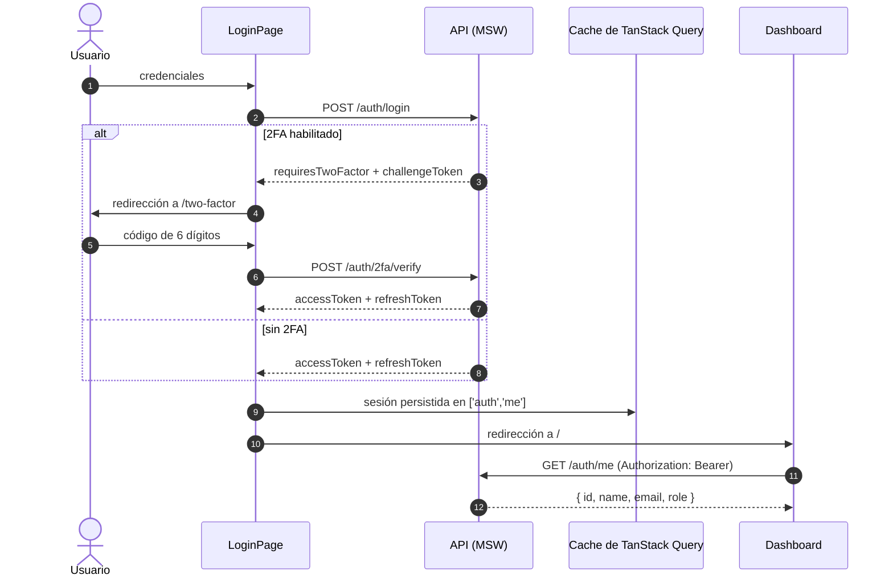
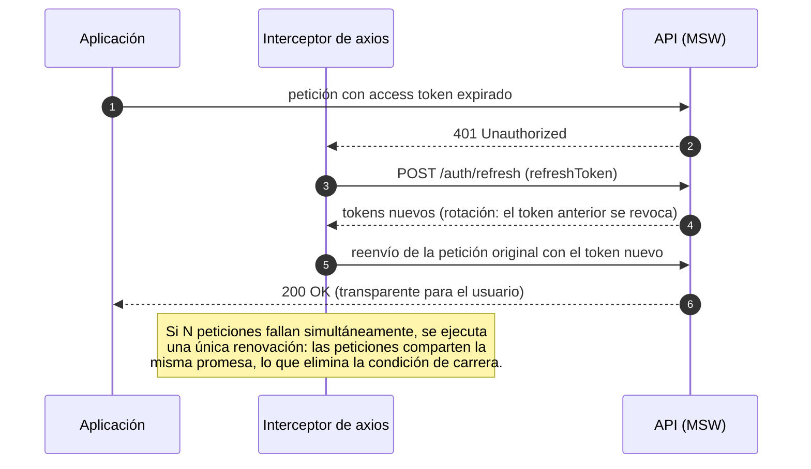
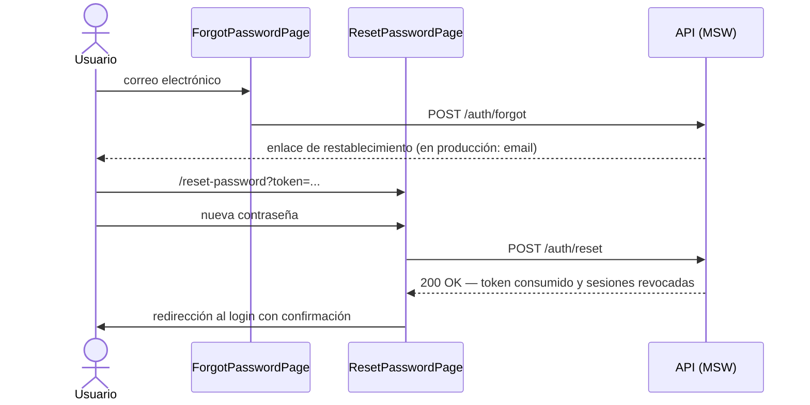

# Smart Routes — Frontend


# Frontend de Smart Routes: gestión de pedidos, generación y validación de rutas, operación de repartidores, reprogramaciones, administración de roles y reportes para una empresa de logística de última milla.
# Sistema de Autenticación — Frontend


Frontend de Smart Routes: gestión de pedidos, generación y validación de rutas, operación de repartidores, reprogramaciones, administración de roles y reportes para una empresa de logística de última milla.

La capa de red opera sobre una **API simulada con MSW (Mock Service Worker)** que actúa como *contrato ejecutable*: define de forma tipada los endpoints, payloads y códigos de estado que el backend real debe implementar. El frontend no requiere modificaciones para migrar a la API definitiva.

---

## Índice

1. [Características](#-características)
2. [Stack tecnológico](#-stack-tecnológico)
3. [Instalación y ejecución](#-instalación-y-ejecución)
4. [Usuarios de prueba](#-usuarios-de-prueba)
5. [Arquitectura de autenticación](#-arquitectura-de-autenticación)
6. [Estructura del proyecto](#-estructura-del-proyecto)
7. [Contrato de la API](#-contrato-de-la-api)
8. [Decisiones de seguridad](#-decisiones-de-seguridad)
9. [Estado del proyecto](#-estado-del-proyecto)

## 📌 Características

| Módulo | Descripción |
|---|---|
| Registro | Alta de usuarios con medidor de fortaleza de contraseña y manejo del conflicto 409 como error de campo |
| Login | Validación con Zod, opción "recordarme", visibilidad de contraseña |
| 2FA | Verificación OTP de 6 dígitos (auto-avance, pegado, retroceso) y reenvío con periodo de espera |
| Recuperación | Solicitud de restablecimiento y cambio de contraseña mediante token de un solo uso |
| Sesión | Tokens con rotación, renovación automática ante 401 sin interrumpir al usuario |
| Zona privada | Guardas de rutas (autenticado / invitado), perfil y cambio de contraseña |
| Operación | Dashboard con KPIs, banco de pedidos, rutas y reprogramaciones |
| Repartidor | Rutas asignadas, registro de entregas e incidencias |
| Administración | Gestión de roles para usuarios administradores |
| Reportes | Seis consultas, ordenamiento por columnas y exportación mediante impresión PDF |
| Resiliencia | Mensaje de estado offline, ErrorBoundary global, bloqueo temporal 429 con cuenta regresiva |
| Notificaciones | Sistema de toasts global sobreviviente a la navegación |

## 🧱 Stack tecnológico

| Tecnología | Versión | Responsabilidad |
|---|---|---|
| React | 19 | Biblioteca de UI (React Compiler habilitado) |
| Vite | 7 | Empaquetador y servidor de desarrollo |
| TypeScript | 5.9 | Tipado estático estricto |
| TanStack Query | 5 | Gestión del estado del servidor (sesión en cache) |
| React Hook Form + Zod | — | Formularios no controlados con validación por schema |
| axios | — | Cliente HTTP con interceptores de autenticación |
| Tailwind CSS | 4 | Sistema de estilos |
| MSW | 3 | Simulación de la API a nivel de red |

## ⚙️ Instalación y ejecución

**Requisitos:** Node.js 20+ y npm.

```bash
npm install
VITE_ENABLE_MOCKS=true npm run dev
```

La aplicación se sirve en `http://localhost:5173`.

Para usar el backend real, desactiva MSW y configura `VITE_API_URL` con la URL del servidor.

### Variables de entorno

Usa `.env.example` como plantilla (git lo ignora — cópialo a `.env.development`):

```env
VITE_ENABLE_MOCKS=true
VITE_API_URL=/api
```

La migración al backend real no requiere cambios de código: basta con desactivar el mock y apuntar `VITE_API_URL` al servidor definitivo (los cambios de entorno requieren reiniciar el servidor de desarrollo).

## 👥 Usuarios de prueba

| Usuario | Contraseña | Rol (contrato backend) | Observaciones |
|---|---|---|---|
| `ana@demo.dev` | `Password123!` | `LogisticsCoordinator` | 2FA habilitado; el código de verificación (`123456`) se imprime por consola |
| `carlos@demo.dev` | `Password123!` | `Administrator` | Sin 2FA |
| `sofia@demo.dev` | `Password123!` | `OperationsSupervisor` | Sin 2FA; valida y aprueba rutas |
| `marco@demo.dev` | `Password123!` | `DeliveryPerson` | Sin 2FA; ve sus rutas y registra entregas |

Los roles son los definidos en `src/Domain/Constants/Roles.cs` del backend — el mock usa los nombres exactos que enviará el .NET. El registro público crea `LogisticsCoordinator` por defecto; los demás roles los asigna un administrador.

Por seguridad, la cuenta se bloquea temporalmente (HTTP 429) tras **5 intentos fallidos** de inicio de sesión.

## 🔄 Arquitectura de autenticación

### Flujo de inicio de sesión (con y sin 2FA)



### Renovación automática de sesión



### Recuperación de contraseña



## 🗂️ Estructura del proyecto

```
src/
├── api/
│   ├── http.ts            # Instancia axios, interceptores (Bearer, renovación
│   │                      #   con promesa compartida, evento session-expired)
│   └── auth.api.ts        # Contrato tipado: una función por endpoint
├── features/auth/
│   ├── AuthProvider.tsx   # Sesión como singleton: consulta /me, escucha
│   │                      #   auth:session-expired, expone useAuth()
│   └── schemas.ts         # Schemas Zod de todos los formularios y sus tipos
├── mocks/
│   ├── db.ts              # Estado en memoria del mock (persistencia selectiva)
│   └── handlers.ts        # Definición de los 9 endpoints (el contrato)
├── components/
│   ├── ErrorBoundary.tsx  # Contención global de errores de render
│   └── ui/                # Componentes reutilizables (TextField, Toast)
├── pages/
│   ├── auth/              # Login, Register, TwoFactor, Forgot, Reset, Layout
│   ├── DashboardPage.tsx  # Zona privada (protegida por RequireAuth)
│   ├── ProfilePage.tsx    # Perfil de usuario y cambio de contraseña
│   └── NotFoundPage.tsx   # Página 404 propia
└── routes/guards.tsx      # RequireAuth / RequireGuest (protección de rutas)
```

## 📜 Contrato de la API

Especificación que el backend real debe implementar. Referencia completa de payloads en `src/mocks/handlers.ts` y cliente tipado en `src/api/auth.api.ts`.

| Método | Ruta | Cuerpo | Respuesta | Códigos |
|---|---|---|---|---|
| POST | `/api/auth/register` | `{ name, email, password }` | `{ user }` | 201 · 409 |
| POST | `/api/auth/login` | `{ email, password }` | tokens **o** `requiresTwoFactor` | 200 · 401 · 429 |
| POST | `/api/auth/2fa/verify` | `{ challengeToken, code }` | tokens | 200 · 401 |
| POST | `/api/auth/2fa/resend` | `{ challengeToken }` | `{ message }` | 200 · 401 |
| POST | `/api/auth/refresh` | `{ refreshToken }` | tokens renovados (rotación) | 200 · 401 |
| POST | `/api/auth/forgot` | `{ email }` | `{ message }` — respuesta siempre 200 | 200 |
| POST | `/api/auth/reset` | `{ token, newPassword }` | `{ message }` | 200 · 400 |
| POST | `/api/auth/change-password` | `{ currentPassword, newPassword }` + Bearer | `{ message }` | 200 · 400 · 401 |
| GET | `/api/auth/me` | — + Bearer | `{ id, name, email, role }` | 200 · 401 |

Formato de tokens: JWT simulado `header.payload.firma`, con `sub` (identificador de usuario) y `exp` (15 minutos) en el payload. El access token viaja en el encabezado `Authorization: Bearer`; el refresh token debe implementarse en producción como **cookie `httpOnly`** (el mock lo acepta también en el cuerpo para facilitar las pruebas manuales).

## 🛡️ Decisiones de seguridad

- **Prevención de enumeración de usuarios:** el login responde con un mensaje idéntico ante correo inexistente o contraseña incorrecta; `forgot` responde siempre 200 con mensaje genérico, independiente de la existencia del correo.
- **Mitigación de fuerza bruta:** bloqueo temporal de la cuenta tras 5 intentos fallidos, comunicando el estado con HTTP 429 y cuenta regresiva en la interfaz.
- **Tokens de un solo uso:** el `challengeToken` de 2FA se consume al verificarse; el refresh token rota en cada renovación (el anterior se revoca).
- **Restablecimiento seguro:** el token de recuperación se consume en su primer uso y revoca todas las sesiones activas; el cambio de contraseña aplica la misma política de revocación.
- **Renovación sin condiciones de carrera:** ante N respuestas 401 simultáneas, todas las peticiones comparten una única promesa de renovación (patrón `refreshPromise ??=`).
- **Reintento acotado:** el interceptor reintenta la petición original una sola vez tras renovar; login, 2FA y refresh quedan excluidos del ciclo para evitar bucles infinitos.
- **Validación en dos capas:** schemas Zod en el cliente (retroalimentación inmediata) y validación de equivalentes en el servidor, dado que la confianza en el cliente nunca es total.
- **Mensajería de red fiel:** la ausencia de respuesta (sin conexión o servidor no disponible) se comunica con un mensaje específico, distinto de los errores 4xx del protocolo de aplicación.
- **Contención de fallos de render:** un ErrorBoundary global captura errores de renderizado y presenta una pantalla de recuperación; los errores de eventos y promesas se gestionan de forma independiente.

## 📍 Estado del proyecto

### Verificación manual de los módulos

Con MSW activo, se pueden validar los flujos principales desde el navegador:

1. Login con Carlos y revisión del Dashboard, Perfil y Administración.
2. Login con Ana, código 2FA `123456`, alta de pedidos y generación de rutas.
3. Login con Sofía, aprobación o rechazo de rutas; el rechazo exige observaciones.
4. Login con Marco, consulta de rutas asignadas, registro de entregas e incidencias.
5. Solicitud de reprogramación con Marco y resolución con Ana.
6. Consulta de los seis reportes, ordenamiento por columna y exportación PDF.

El mock vive en memoria. Los cambios de roles, pedidos y rutas no representan persistencia de producción; la persistencia definitiva corresponde al backend y su base de datos.

| Estado | Elemento |
|---|---|
| ✅ Completado | Registro, login, 2FA (verificación y reenvío), bloqueo 429 |
| ✅ Completado | Recuperación y restablecimiento de contraseña |
| ✅ Completado | Cambio de contraseña desde el perfil |
| ✅ Completado | Gestión de sesión (refresh automático, logout, guardas de ruta) |
| ✅ Completado | 404 propia, ErrorBoundary, toasts, estado offline |
| ✅ Completado | AppShell responsive, navegación por rol y Dashboard con KPIs mock |
| ✅ Completado | Pedidos, rutas, validación, entregas y reprogramaciones |
| ✅ Completado | Administración de roles y seis reportes con exportación PDF |
| 🔲 Pendiente | Conectar endpoints mock con la implementación real del backend |
| 🔲 Pendiente | Implementar endpoints de centros y repartidores en el backend |
| 🔲 Pendiente | Transiciones con Framer Motion |
| 🔲 Pendiente | Modo oscuro/claro |
| 🔲 Pendiente | Pruebas unitarias de schemas Zod (Vitest) |
| 🔲 Pendiente | Prueba end-to-end del flujo completo (Playwright) |
| 🔲 Pendiente | Auditoría Lighthouse |
