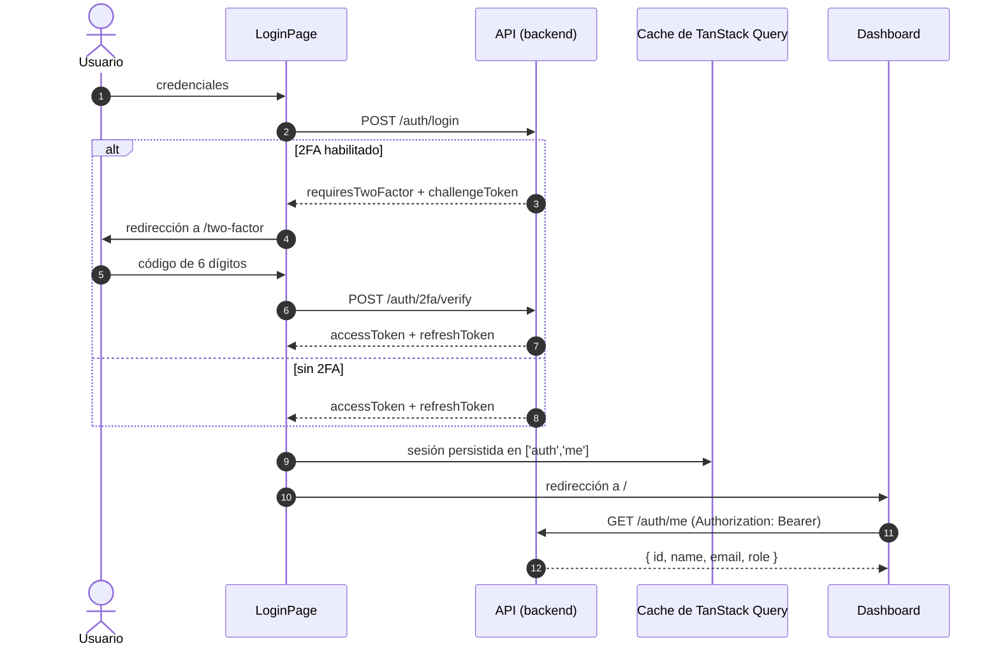
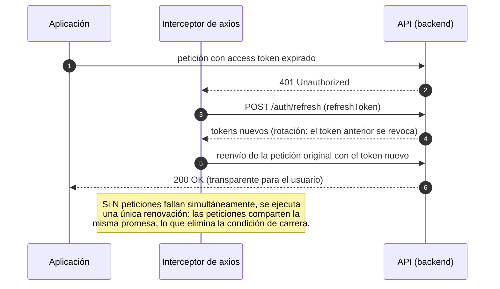
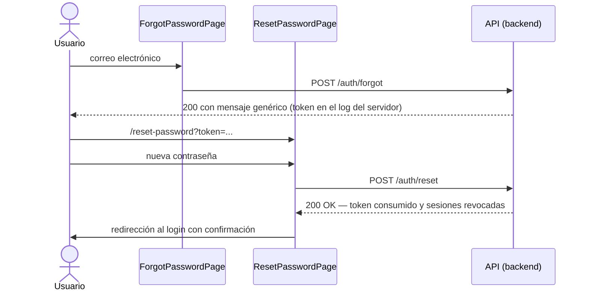

# Smart Routes — Frontend


Frontend de Smart Routes: gestión de pedidos, generación y validación de rutas, operación de repartidores, reprogramaciones, administración de roles y reportes para una empresa de logística de última milla.

La aplicación consume el **backend real** de Smart Routes. El contrato de cada endpoint —método, ruta, roles, payload, respuestas y errores— está documentado en [`docs/endpoints.md`](../docs/endpoints.md), que es la fuente de verdad. **No hay datos simulados en ejecución.**

> El backend vive en `src/Web` (.NET). Para levantar backend y frontend juntos se usa el AppHost de Aspire; consulta el [README raíz](../README.md).

---

## Índice

1. [Características](#-características)
2. [Stack tecnológico](#-stack-tecnológico)
3. [Instalación y ejecución](#-instalación-y-ejecución)
4. [Configuración](#-configuración)
5. [Usuarios demo](#-usuarios-demo)
6. [Arquitectura de autenticación](#-arquitectura-de-autenticación)
7. [Estructura del proyecto](#-estructura-del-proyecto)
8. [Contrato de la API](#-contrato-de-la-api)
9. [Decisiones de seguridad](#-decisiones-de-seguridad)
10. [Estado del proyecto](#-estado-del-proyecto)

## 📌 Características

| Módulo | Descripción |
|---|---|
| Registro | Alta de usuarios con medidor de fortaleza de contraseña y manejo del conflicto 409 como error de campo |
| Login | Validación con Zod, opción "recordarme", visibilidad de contraseña |
| 2FA | Verificación OTP de 6 dígitos (auto-avance, pegado, retroceso) y reenvío |
| Recuperación | Solicitud de restablecimiento y cambio de contraseña mediante token de un solo uso |
| Sesión | Tokens con rotación, renovación automática ante 401 sin interrumpir al usuario |
| Zona privada | Guardas de rutas (autenticado / invitado), perfil y cambio de contraseña |
| Operación | Banco de pedidos, rutas y reprogramaciones contra los endpoints reales |
| Repartidor | Rutas asignadas, registro de entregas e incidencias |
| Administración | Gestión de roles, centros, zonas y actores |
| Reportes | Reporte real de entregas por centro; el resto depende del backend |
| Resiliencia | Mensaje de estado offline, ErrorBoundary global y toasts |
| Dashboard | KPIs cuando el backend exponga `/dashboard/summary` (pendiente) |

## 🧱 Stack tecnológico

| Tecnología | Versión | Responsabilidad |
|---|---|---|
| React | 19 | Biblioteca de UI (React Compiler habilitado) |
| Vite | 8 | Empaquetador y servidor de desarrollo |
| TypeScript | 7.0 | Tipado estático estricto |
| TanStack Query | 5 | Gestión del estado del servidor (sesión en cache) |
| React Hook Form + Zod | — | Formularios no controlados con validación por schema |
| axios | — | Cliente HTTP con interceptores de autenticación |
| Tailwind CSS | 4 | Sistema de estilos |
| Vitest + Testing Library | — | Pruebas unitarias y de integración de pantallas |

## ⚙️ Instalación y ejecución

**Requisitos:** Node.js 20.19+ (o 22.12+) y npm. El backend debe estar corriendo para que la aplicación cargue datos.

```bash
npm install
npm run dev
```

La aplicación se sirve en `http://localhost:5173`. En desarrollo, Vite proxea `/api` al backend según `vite.config.ts` (Aspire inyecta la URL).

### Pruebas y calidad

```bash
npm test        # Vitest + Testing Library
npm run lint    # oxlint
npm run build   # TypeScript + build de producción
```

El flujo de integración continua de `.github/workflows/frontend-ci.yml` ejecuta estas tres comprobaciones en cada PR y en cada push a `develop`.

## 🔧 Configuración

Usa `.env.example` como plantilla (git lo ignora — cópialo a `.env.development`):

```env
# URL base de la API. En desarrollo Vite la proxea según vite.config.ts.
VITE_API_URL=/api
```

Si `VITE_API_URL` apunta a una URL absoluta, el frontend llama directamente a ese servidor. Los cambios de entorno requieren reiniciar el servidor de desarrollo.

## 👥 Usuarios demo

El backend crea usuarios de demostración al arrancar en Development. La lista completa, roles y datos seed están en [`docs/endpoints.md` §18](../docs/endpoints.md#18-usuarios-y-datos-demo).

- `carlos@demo.dev` — `Administrator`
- `ana@demo.dev` — `LogisticsCoordinator`
- `sofia@demo.dev` — `OperationsSupervisor`
- `marco@demo.dev` — `DeliveryPerson`

Contraseña común: `Password123!`.

> **Limitaciones actuales:** los usuarios demo **no tienen 2FA habilitado** por defecto. El bloqueo por fuerza bruta (429) y la cookie `httpOnly` para el refresh token **no están implementados en el backend**; el token de recuperación de contraseña se escribe en el log del servidor, no en la consola del navegador.

## 🔄 Arquitectura de autenticación

### Flujo de inicio de sesión (con y sin 2FA)



### Renovación automática de sesión



### Recuperación de contraseña



## 🗂️ Estructura del proyecto

```
src/
├── api/
│   ├── http.ts            # Instancia axios, interceptores (Bearer, renovación
│   │                      #   con promesa compartida, evento session-expired)
│   ├── auth.api.ts        # Contrato tipado: una función por endpoint
│   └── *.api.ts           # Pedidos, rutas, paradas, centros, reportes, etc.
├── features/auth/
│   ├── AuthProvider.tsx   # Sesión como singleton: consulta /me, escucha
│   │                      #   auth:session-expired, expone useAuth()
│   └── schemas.ts         # Schemas Zod de todos los formularios y sus tipos
├── components/
│   ├── ErrorBoundary.tsx  # Contención global de errores de render
│   ├── RouteMap.tsx       # Mapa Leaflet del recorrido de una ruta
│   └── ui/                # Componentes reutilizables (TextField, Toast, tablas…)
├── pages/
│   ├── auth/              # Login, Register, TwoFactor, Forgot, Reset, Layout
│   ├── DashboardPage.tsx  # Zona privada (protegida por RequireAuth)
│   ├── ProfilePage.tsx    # Perfil de usuario y cambio de contraseña
│   └── ...                # Pedidos, rutas, paradas, centros, reportes, admin
├── routes/guards.tsx      # RequireAuth / RequireGuest / RequireRole
└── test/
    ├── handlers/          # Respuestas HTTP fieles al contrato para las pruebas
    └── server.ts          # Servidor de pruebas compartido
```

## 📜 Contrato de la API

La referencia completa está en [`docs/endpoints.md`](../docs/endpoints.md). El cliente tipado de cada módulo vive en `src/api/*.api.ts`.

Estado resumido de la integración:

| Módulo | Estado | Observación |
|---|---|---|
| Auth | Implementado | Refresh y 2FA con limitaciones conocidas |
| Pedidos | Parcial | El backend devuelve array + cabeceras de paginación |
| Paradas | Parcial | Crear y editar devuelven `204` |
| Rutas | Parcial | Falta `reviewState` en `RouteDto`; revisión usa `balanceCritertiaId` |
| Criterios | Implementado | — |
| Centros y zonas | Parcial | Lectura restringida a administradores |
| Entregas | Implementado | Revisar alcance del reporte por centro |
| Reprogramaciones | Parcial | Nombre del coordinador es un placeholder |
| Dashboard | No existe | `GET /dashboard/summary` pendiente |
| Reportes | No existe | Solo existe `GET /delivery/reports/by-center` |
| Clasificación | No existe | Botón “Clasificar” deshabilitado |

Los pendientes de backend y las decisiones abiertas están en [`frontend/tasklist.md`](tasklist.md).

## 🛡️ Decisiones de seguridad

- **Prevención de enumeración de usuarios:** el login responde con un mensaje idéntico ante correo inexistente o contraseña incorrecta; `forgot` responde siempre 200 con mensaje genérico.
- **Tokens de un solo uso:** el `challengeToken` de 2FA se consume al verificarse; el refresh token rota en cada renovación (el anterior se revoca).
- **Restablecimiento seguro:** el token de recuperación se consume en su primer uso y revoca todas las sesiones activas; el cambio de contraseña aplica la misma política de revocación.
- **Renovación sin condiciones de carrera:** ante N respuestas 401 simultáneas, todas las peticiones comparten una única promesa de renovación (patrón `refreshPromise ??=`).
- **Reintento acotado:** el interceptor reintenta la petición original una sola vez tras renovar; login, 2FA y refresh quedan excluidos del ciclo para evitar bucles infinitos.
- **Validación en dos capas:** schemas Zod en el cliente (retroalimentación inmediata) y validación en el servidor.
- **Mensajería de red fiel:** la ausencia de respuesta (sin conexión o servidor no disponible) se comunica con un mensaje específico, distinto de los errores 4xx.
- **Contención de fallos de render:** un ErrorBoundary global captura errores de renderizado y presenta una pantalla de recuperación.

> **Riesgos pendientes:** el refresh token se guarda en `localStorage` (no en cookie `httpOnly`), no hay rate limiting real (429) y CORS está abierto. Ver hallazgos R-13 y R-14 en [`docs/endpoints.md`](../docs/endpoints.md#16-hallazgos-de-integración).

## 📍 Estado del proyecto

| Estado | Elemento |
|---|---|
| ✅ Completado | Registro, login, 2FA (verificación y reenvío) |
| ✅ Completado | Recuperación y restablecimiento de contraseña |
| ✅ Completado | Cambio de contraseña desde el perfil |
| ✅ Completado | Gestión de sesión (refresh automático, logout, guardas de ruta) |
| ✅ Completado | 404 propia, ErrorBoundary, toasts, estado offline |
| ✅ Completado | AppShell responsive, navegación por rol |
| ✅ Completado | Pedidos, rutas, paradas, centros, entregas y reprogramaciones |
| ✅ Completado | Administración de roles y reporte de entregas por centro |
| ✅ Completado | Pruebas de schemas, guardas, formularios, contratos y renovación de tokens |
| 🔲 Pendiente | Dashboard y reportes: endpoints de backend |
| 🔲 Pendiente | Estado real de revisión de rutas (`reviewState`) |
| 🔲 Pendiente | Modo oscuro, transiciones y auditoría Lighthouse |
| 🔲 Pendiente | Prueba end-to-end con Playwright |

La hoja de ruta detallada está en [`tasklist.md`](tasklist.md).
